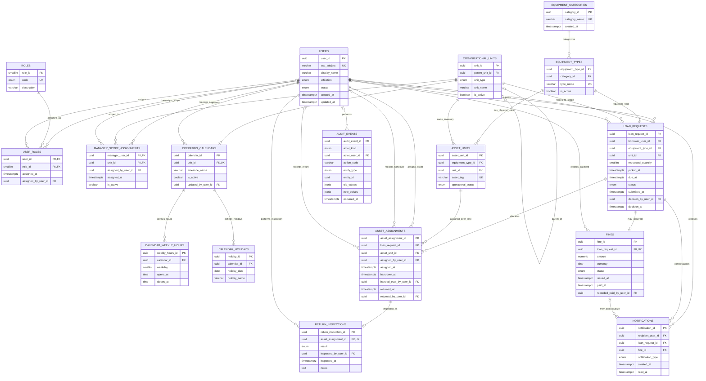

# BorrowHub — Relational ERD

## الغرض والنطاق

هذا المخطط يمثل قاعدة البيانات العلائقية المقترحة لـ BorrowHub MVP وفق `docs/PRD.md` و`docs/user-flow.md`. صيغ Mermaid أدناه قابلة للنسخ إلى Mermaid Live. التصميم منطقي ومتوافق مع أنواع PostgreSQL الشائعة، لكن PRD لم يحدد محرك قاعدة بيانات نهائيًا.

## Mermaid ER Diagram

> `AUDIT_EVENTS.entity_id` هو مرجع متعدد الأنواع (polymorphic) ولا يظهر كعلاقة FK في الرسم؛ تفاصيل المفاضلة موضحة في `docs/database-review.md`.

## قراءة الكيانات والعلاقات

- `USERS` يمثل هوية SSO الجامعية. الصفة طالب/موظف لا تخلط مع صلاحية الدور.
- `ROLES` و`USER_ROLES` يفصلان المستخدم عن صلاحياته ويدعمان إسناد أكثر من دور عند اعتماد ذلك.
- `ORGANIZATIONAL_UNITS` يمثل نطاقات الجامعة الهرمية المحتملة. `MANAGER_SCOPE_ASSIGNMENTS` هو جدول الربط بين المسؤولين والنطاقات.
- `EQUIPMENT_CATEGORIES` و`EQUIPMENT_TYPES` يمثلان تصنيف الكتالوج، بينما `ASSET_UNITS` يسجل كل قطعة فعلية بمعرّف مستقل.
- `OPERATING_CALENDARS` له نطاق واحد، وله عدة فترات أسبوعية وعطلات. يمكن تمثيل أكثر من فترة عمل في اليوم.
- `LOAN_REQUESTS` هو سجل الطلب الذي يستمر ليصبح سجل الاستعارة عند الموافقة؛ لذلك لا توجد نسختان منفصلتان متكررتان للطلب والقرض.
- `ASSET_ASSIGNMENTS` يربط طلب الاستعارة بالقطع الفعلية. العلاقة بين الطلب والقطع هي N:M عبر الزمن، ممثلة بعلاقة 1:N من كل من الطلب والقطعة إلى سجل التخصيص.
- `RETURN_INSPECTIONS` يسجل نتيجة فحص واحدة لكل قطعة مخصصة. الحالة التشغيلية الحالية تحفظ على `ASSET_UNITS`، بينما نتيجة الفحص تاريخية.
- `FINES` اختياري 1:1 مع طلب/استعارة؛ الفهرس الفريد على `loan_request_id` يمنع أكثر من غرامة واحدة لكل استعارة.
- `NOTIFICATIONS` تتبع مستلم الإشعار وطلبه، ويمكن ربط إشعار الغرامة بسجل الغرامة.
- `AUDIT_EVENTS` يحفظ سجل الإجراءات ومنفذها عند توفر مستخدم، أو يحدد أن الفاعل النظام.

## علاقة النموذج بتدفق المستخدم

يبدأ التدفق بتحميل `USERS` عبر معرف SSO ثم التحقق من `USER_ROLES`. يقرأ الكتالوج من `EQUIPMENT_TYPES` و`EQUIPMENT_CATEGORIES` ويحسب الكمية المتاحة من `ASSET_UNITS` والتخصيصات الفعالة. يحفظ الطلب في `LOAN_REQUESTS` ويرسل إشعارات في `NOTIFICATIONS`. يراجع مسؤول المعدات ضمن نطاقه، ثم تسجل القطع المخصصة في `ASSET_ASSIGNMENTS`. التسليم والإرجاع يوثقان على مستوى كل قطعة، ويضاف فحص في `RETURN_INSPECTIONS`. عند التأخير، ينشأ `FINES` مرة واحدة وتُسجل التنبيهات، ويُحفظ الدفع اليدوي وسائر التغييرات المهمة في `AUDIT_EVENTS`.

## ملاحظات على cardinality

| العلاقة | الكاردينالية | سببها |
|---|---|---|
| User ↔ Role | M:N عبر `USER_ROLES` | المستخدم قد يحمل أكثر من دور، والدور يشمل مستخدمين كثيرين |
| Manager ↔ Organizational unit | M:N عبر `MANAGER_SCOPE_ASSIGNMENTS` | المسؤول قد يدير نطاقات متعددة، والنطاق قد يخدمه أكثر من مسؤول |
| Category → Equipment type | 1:N | الفئة تضم أنواعًا متعددة، والنوع يتبع فئة واحدة |
| Equipment type → Asset unit | 1:N | النوع له قطع مادية كثيرة، والقطعة تتبع نوعًا واحدًا |
| User → Loan request | 1:N | المستخدم يستطيع تقديم طلبات عديدة عبر الزمن |
| Loan request ↔ Asset unit | M:N عبر `ASSET_ASSIGNMENTS` | الطلب قد يحتاج عدة قطع، والقطعة يعاد تخصيصها لطلبات متعاقبة؛ يمنع تداخل الحيازة |
| Assignment → Return inspection | 1:0..1 | قد لا يكون الإرجاع قد حصل بعد؛ بعد الإرجاع يسجل فحص واحد للقطعة |
| Loan request → Fine | 1:0..1 | ليست كل استعارة متأخرة؛ غرامة واحدة كحد أقصى لكل استعارة |
| Operating calendar → weekly hours/holidays | 1:N | لكل تقويم عدة أيام/فترات عمل وعطلات |
