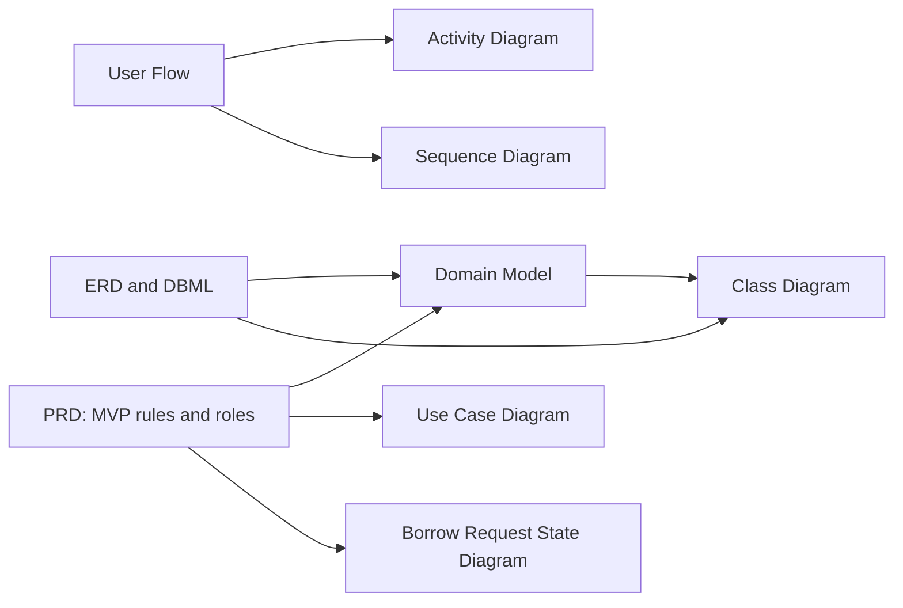

# BorrowHub MVP — UML & System Analysis Diagrams

## Diagram title

**خريطة وثائق التحليل والمخططات**

## Purpose

هذا الملف فهرس تسليم المخططات الستة ويبين علاقة وثائق المصدر بالمخرجات. الشيفرات الكاملة والشروح التفصيلية موجودة في ملفات كل مخطط.

## Source requirements

المصادر المعتمدة حصريًا:

- `docs/PRD.md`
- `docs/user-flow.md`
- `docs/ERD.md`
- `docs/database.dbml`

## Valid code

## شرح بالعربية

تحدد وثائق PRD القواعد والأدوار، ويشرح User Flow الرحلة الفعلية؛ لذلك يستند إليهما مخطط النشاط والتسلسل وحالات الاستخدام ودورة الحالة. أما ERD وDBML فيحددان الكيانات والعلاقات التي يغطيها نموذج المجال ومخطط الفئات. هذا الرسم خريطة للوثائق وليس مخططًا معماريًا لتقنيات التنفيذ.

## ملفات المخططات

| الملف | المحتوى |
|---|---|
| [`domain-model.md`](domain-model.md) | نموذج المجال المفاهيمي بصيغة Mermaid `classDiagram` |
| [`use-case.md`](use-case.md) | حالات الاستخدام والفاعلون بصيغة PlantUML |
| [`activity-diagram.md`](activity-diagram.md) | تدفق الأعمال والقرارات بصيغة Mermaid `flowchart TD` |
| [`sequence-diagram.md`](sequence-diagram.md) | الرسائل بين الفاعلين والأنظمة بصيغة Mermaid `sequenceDiagram` |
| [`state-diagram.md`](state-diagram.md) | دورة حياة Loan Request بصيغة Mermaid `stateDiagram-v2` |
| [`class-diagram.md`](class-diagram.md) | مخطط فئات تصميمي مفاهيمي بصيغة Mermaid `classDiagram` |

## Assumptions

- المخططات توثق MVP فقط؛ لا تضيف دفعًا إلكترونيًا، بريدًا/رسائل نصية، QR، تطبيقات جوال، أو تكاملات غير معتمدة.
- University SSO هو نظام خارجي وحيد ظاهر في حالات الاستخدام؛ مزوده غير محدد.
- System Administrator دور موصى به في PRD، وليس قرارًا مؤسسيًا مكتمل الاعتماد.
- Borrow Request يمثل سجل الاستعارة بعد الموافقة في النموذج الحالي لتفادي تكرار بيانات الطلب والقرض.

## Open questions

- نطاق الإطلاق المؤسسي: الجامعة كلها أم كلية/قسم؟
- هل يحجز الطلب المعلق المخزون؟ وما تصرف المسؤول إذا نفدت الكمية قبل الموافقة؟
- متى تُخصص القطع الفردية؟ ومتى تنتهي حالة الاستعارة النشطة؟
- هل الطلب يدعم أكثر من نوع معدّة؟
- ما المنطقة الزمنية وفترة السماح والتوقيتان الدقيقان للتذكير؟
- ما سياسة عدم الحضور، وصلاحيات الدفع/تصحيح الغرامة؟

## قواعد الاتساق والتحقق

- مخطط Mermaid لكل من المجال والنشاط والتسلسل والحالة والفئات، ومخطط PlantUML لحالات الاستخدام.
- مخطط حالات الاستخدام يميز المستعير ومسؤول المعدات والفاعل الخارجي SSO، ويعرض مدير النظام كدور موصى به.
- كل قرار غير محسوم في المصدر يظهر كسؤال مفتوح أو وسم TBD، ولا يحسمه الرسم ضمنيًا.
- الملفات لا تتضمن شيفرة تطبيق أو migrations.
