# BorrowHub MVP — Activity Diagram

## Purpose

يمثل هذا المخطط تدفق النشاط من تسجيل الدخول حتى إغلاق الاستعارة أو بقائها متأخرة/غير محسومة. تظهر فيه أنشطة المستعير والنظام ومسؤول المعدات، والتحقق من الأهلية والمواعيد والتوفر ومسارات الفشل والبدائل.

## Source requirements

- `docs/PRD.md`: FR-001, FR-008–FR-029، User Flows، Edge Cases، Error States.
- `docs/user-flow.md`: التدفق الرئيسي والرفض والإلغاء والانتهاء والتأخير.
- `docs/ERD.md`: الطلب، تخصيص القطع، الفحص، الغرامة والإشعار.

## Valid code

```mermaid
flowchart TD
    Start([Start]) --> Login[Borrower signs in through university SSO]
    Login --> Auth{SSO authentication and account access valid?}
    Auth -->|No| AuthError[Show sign-in or access error]
    AuthError --> EndAuth([End: Access not granted])
    Auth -->|Yes| Browse[Browse catalog and select equipment type]
    Browse --> Form[Enter quantity, pickup time, and return time]
    Form --> Eligible{No borrowing block and fewer than two approved active loans?}
    Eligible -->|No| Blocked[Show overdue, unpaid fine, or loan-limit reason]
    Blocked --> EndBlocked([End: Request blocked])
    Eligible -->|Yes| ValidDates{Duration at most ten calendar days and times within configured work calendar?}
    ValidDates -->|No| DateError[Show validation error]
    DateError --> Form
    ValidDates -->|Yes| Available{Requested quantity available for the interval?}
    Available -->|No| AvailabilityError[Show unavailable quantity or interval]
    AvailabilityError --> EditRequest[Borrower changes quantity or dates]
    EditRequest --> Form
    Available -->|Yes| Submit[Borrower submits request]
    Submit --> SavePending[System records request as pending review]
    SavePending --> Notify[System creates in-app notifications for borrower and responsible manager]
    Notify --> Cancel{Borrower cancels before manager approval?}
    Cancel -->|Yes| CancelRequest[System marks request cancelled]
    CancelRequest --> EndCancel([End: Cancelled])
    Cancel -->|No| PickupReached{Requested pickup start reached before review?}
    PickupReached -->|Yes| Expire[System expires request and notifies borrower]
    Expire --> EndExpired([End: Expired])
    PickupReached -->|No| ManagerReview[Equipment manager reviews request in assigned scope]
    ManagerReview --> ManagerDecision{Manager chooses approve?}
    ManagerDecision -->|No| Reject[System records rejection and notifies borrower]
    Reject --> EndRejected([End: Rejected])
    ManagerDecision -->|Yes| Recheck{Availability still sufficient at approval?}
    Recheck -->|No| Conflict[Block approval and show stock conflict]
    Conflict --> ResolveConflict{Manager rejects the request?}
    ResolveConflict -->|Yes| Reject
    ResolveConflict -->|No| PickupReached
    Recheck -->|Yes| Assign[Manager assigns physical asset units]
    Assign --> Approve[System records approval and notifies borrower]
    Approve --> Handover[At pickup, manager manually records handover]
    Handover --> CheckedOut[System records assigned units as checked out]
    CheckedOut --> OnTime{Return recorded by due time?}
    OnTime -->|Yes| Return[Manager records return and inspects each returned unit]
    OnTime -->|No| Overdue[System marks loan overdue and creates one USD 50 fine]
    Overdue --> Reminders[System sends two in-app reminders within first 24 hours]
    Reminders --> BorrowerReturns{Borrower returns the equipment?}
    BorrowerReturns -->|No| StillOverdue[Keep loan overdue and block new requests]
    StillOverdue --> EndAwait([End: Await return and fine settlement])
    BorrowerReturns -->|Yes| Return
    Return --> Condition[Manager records good, damaged, or incomplete/missing result]
    Condition --> FinalStatus[Manager manually selects each asset's final status]
    FinalStatus --> FineExists{Fine exists for this loan?}
    FineExists -->|No| EndReturned([End: Returned and inspected])
    FineExists -->|Yes| FinePaid{Fine paid outside BorrowHub?}
    FinePaid -->|No| Unpaid[Keep fine unpaid; new requests remain blocked]
    Unpaid --> EndUnpaid([End: Return complete; fine settlement pending])
    FinePaid -->|Yes| MarkPaid[Authorized manager records fine as paid manually]
    MarkPaid --> EndPaid([End: Return, inspection, and fine status recorded])
```

## الشرح بالعربية

1. يبدأ المسار بتسجيل الدخول عبر SSO. فشل الهوية أو عدم وجود صلاحية ينهي الرحلة دون إنشاء طلب.
2. يدخل المستعير النوع والكمية وموعدي الاستلام والإرجاع. يتحقق النظام من عدم تجاوز حد الطلبين النشطين، وعدم وجود استعارة متأخرة أو غرامة غير مدفوعة، ثم يطبق حد العشرة أيام وساعات العمل والعطل.
3. إذا فشل التاريخ، يعود المستخدم للتعديل. إذا لم تتوفر الكمية للفترة، يمنع النظام الإرسال ويتيح تغيير الكمية أو الموعد. عند نجاح التحقق، يُسجل الطلب قيد المراجعة وترسل إشعارات داخل التطبيق.
4. يمكن للمستعير إلغاء الطلب قبل الموافقة. وإذا لم تتم مراجعته قبل بداية موعد الاستلام، ينتهي تلقائيًا ويُخطر المستعير.
5. يوافق مسؤول المعدات أو يرفض. قبل إتمام الموافقة، يعيد النظام فحص التوفر. التعارض يمنع الموافقة؛ مصير الطلب بعد التعارض غير محسوم، لذلك يعرض المخطط خيار رفضه أو استمرار الانتظار حتى القرار/انتهاء الموعد.
6. بعد الاعتماد وتخصيص القطع، يسجل المسؤول التسليم يدويًا. عند الإرجاع يسجل نتيجة الفحص ويحدد الحالة النهائية يدويًا.
7. إذا تجاوز الموعد، ينشئ النظام غرامة واحدة قدرها 50 دولارًا ويرسل تذكيرين خلال أول 24 ساعة. الدفع خارج BorrowHub ويسجله مسؤول مخول يدويًا؛ لا يوجد دفع إلكتروني في MVP.

## Assumptions

- حالة “أقل من طلبين نشطين” تُحسب على الطلبات المعتمدة النشطة كما في PRD، لكن تعريف نهاية النشاط ما زال مفتوحًا.
- حظر الطلب عند التأخير أو وجود غرامة غير مدفوعة وانتهاء الطلب غير المراجع اختيارات موثقة في PRD بناء على تفويض المالك للمحلل.
- إتمام الإرجاع يتطلب تسجيل نتيجة الفحص لكل قطعة؛ توقيت إغلاق الطلب النهائي يحتاج اعتمادًا.
- التخصيص يحدث ضمن سير الاعتماد/التسليم؛ اللحظة الدقيقة غير محسومة.

## Open questions

- هل الطلب المعلق يحجز الكمية؟
- ما التصرف النهائي لطلب حدث له تعارض توفر عند الموافقة؟
- هل الاستعارة النشطة تنتهي عند تسجيل الإرجاع أم بعد اكتمال الفحص؟
- ما المنطقة الزمنية وفترة السماح بعد موعد الإرجاع؟
- ما وقتا التذكير المحددان؟
- ما الإجراء عند عدم حضور المستعير للاستلام؟
- هل طلب واحد يضم نوعًا واحدًا أم أنواعًا متعددة؟
