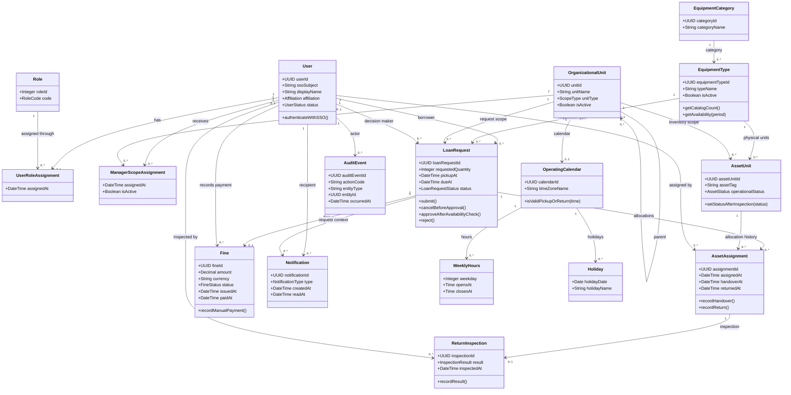

# BorrowHub MVP — Design-Level Class Diagram

## Purpose

يعرض مخطط الفئات التصميمي بنية الكيانات وحقولها الأساسية وروابطها وكارديناليتها، مستندًا إلى نموذج DBML. هو وصف بنيوي تحليلي فقط؛ لا يتضمن كود تطبيق أو تفاصيل إطار عمل أو بنية نشر.

## Source requirements

- `docs/PRD.md`: Data Requirements, Roles & Permissions, FR-001–FR-030.
- `docs/user-flow.md`: تدفق الطلب والموافقة والتسليم والإرجاع.
- `docs/ERD.md` و`docs/database.dbml`: الجداول وPK/FK والعلاقات.

## Valid code

## الشرح بالعربية

المخطط يترجم النموذج المفاهيمي إلى فئات ذات خصائص وأنواع بيانات مفهومة، مع عمليات نطاقية مختصرة مثل إلغاء طلب قبل الموافقة وتسجيل التسليم أو الدفع. هذه أسماء سلوكية تحليلية وليست توقيعًا نهائيًا لواجهات برمجية.

- `User`, `Role`, و`UserRoleAssignment` يمثلون الهوية والصلاحيات دون اعتبار الطالب والموظف صنفين برمجيين منفصلين.
- `EquipmentType` يمثل عنصر الكتالوج، و`AssetUnit` كل قطعة فعلية. `getCatalogCount()` و`getAvailability(period)` قيم مشتقة؛ لا تخزن كنسخ مكررة.
- `LoanRequest` يدير دورة الطلب/الاستعارة. `AssetAssignment` يربط الطلب بالقطع الفعلية وسجلات الحيازة.
- `ReturnInspection` و`Fine` منفصلان عن الطلب لأنهما سجلات اختيارية/تابعة وتملك بيانات دورة خاصة.
- `OperatingCalendar`, `WeeklyHours`, و`Holiday` تدعم التحقق من المواعيد.
- `AuditEvent` يربط الإجراء بفاعل وهدف، مع ملاحظة أن مرجع الهدف من نوع متعدد لا يمثل FK تقليديًا.

## Assumptions

- الخصائص المعروضة حد أدنى مفاهيمي من DBML؛ لم يحدد المشروع قاعدة البيانات أو طريقة إنشاء UUID.
- `LoanRequest` يجمع الطلب والقرض لتجنب ازدواج السجلات في MVP.
- عمليات الفئات تصف سلوكًا مشتقًا من المتطلبات فقط؛ لا تستلزم تصميم تطبيق أو شيفرة.
- نوع الطلب واحد لكل سجل؛ الطلبات متعددة المعدات تتطلب `LoanRequestItem` إضافيًا.

## Open questions

- ما نطاق جدول المؤسسة والوحدات عند إطلاق المشروع؟
- هل تُمنح الأدوار متعددة للمستخدم، أم تُفرض حصريتها؟
- هل يستطيع الموظف المسؤول أن يكون مستعيرًا أيضًا؟
- ما توقيت تعيين القطع ودورة إغلاق الاستعارة؟
- ما هو مصدر الحقيقة للعدد والحالة الكلية المعروضة للنوع؟ التوصية اشتقاقهما من الأصول الفردية.
- ما المنطقة الزمنية وقواعد التعامل مع تغير التقويم بعد تقديم الطلب؟
