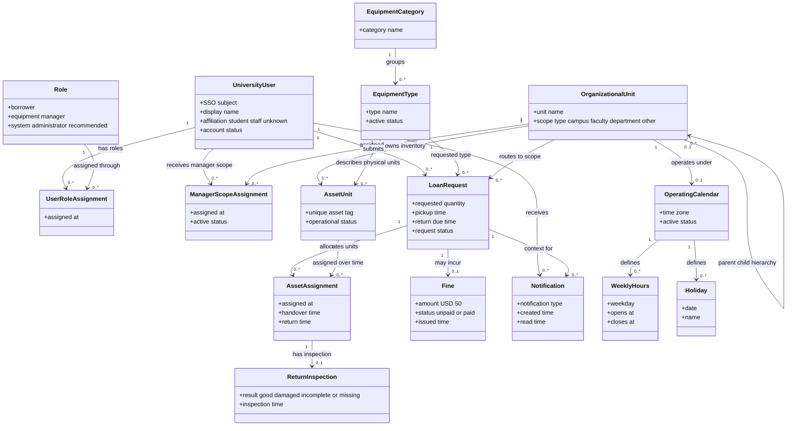

# BorrowHub MVP — Domain Model

## Purpose

يعرض نموذج المجال مفاهيم BorrowHub الأساسية وعلاقاتها على مستوى الأعمال، دون ربطها بتقنية تنفيذ أو تحويلها إلى مخطط قاعدة بيانات حرفي. يركز على المستخدم، الأدوار، نطاقات الجامعة، المعدات الفردية، الطلب/الاستعارة، التخصيص، الفحص، الغرامة والإشعارات.

## Source requirements

- `docs/PRD.md`: Product Overview, Target Users, User Stories, Functional Requirements FR-001–FR-030, Data Requirements, Roles & Permissions.
- `docs/user-flow.md`: تسجيل الطلب ومراجعته وتخصيص الأصل والتسليم والإرجاع والتأخير.
- `docs/ERD.md` و`docs/database.dbml`: الكيانات والعلاقات المقترحة؛ يُستخدمان مرجعًا لا مصدرًا لقواعد أعمال إضافية.

## Valid code

## الشرح بالعربية

- **UniversityUser** يمثل هوية طالب أو موظف بعد الدخول عبر SSO. الدور والصِفة مفهومان منفصلان: affiliation قد تكون طالبًا أو موظفًا، بينما Role يحدد صلاحية Borrower أو Equipment Manager أو System Administrator الموصى به.
- **OrganizationalUnit** يمثل نطاق المخزون والإدارة، وقد يكون الحرم أو الكلية أو القسم. العلاقة الذاتية تسمح بهيكل هرمي من دون فرض أن الإطلاق يغطي الجامعة كلها.
- **EquipmentType** يمثل تعريفًا في الكتالوج، أما **AssetUnit** فيمثل كل قطعة فعلية ذات معرّف منفرد. عدد القطع وحالة توفرها يعتمدان على القطع الفردية والتخصيصات؛ لا ينبغي تكرار الإجمالي يدويًا.
- **LoanRequest** يحمل نوع المعدّة والكمية والفترة وحالة دورة الطلب. بعد الموافقة يُدار كسجل الاستعارة نفسها لتفادي تكرار البيانات.
- **AssetAssignment** يربط الطلب بالقطع الفعلية؛ هذه علاقة متعددة إلى متعددة عبر الزمن. كل تخصيص يوثق أوقات الإسناد والتسليم والإرجاع.
- **ReturnInspection** يوثق نتيجة فحص القطعة بعد الإرجاع. يقرر مسؤول المعدات حالة القطعة النهائية يدويًا.
- **Fine** اختيارية لكل استعارة، وبحد أقصى غرامة واحدة. الدفع يدوي في MVP.
- **OperatingCalendar** يربط نطاق التشغيل بساعات العمل والعطل. توقيت المنطقة الرسمية ما زال سؤالًا مفتوحًا.

المخطط يميز بين العلاقات المفاهيمية وقرارات قاعدة البيانات. لا يعني أن المستخدمين أنواع فرعية مختلفة في البرمجيات؛ الأدوار تُسنَد للمستخدمين، وقد يُمنح المستخدم أكثر من دور إذا سمحت السياسة.

## Assumptions

- كل طلب يحتوي نوع معدّة واحدًا وكمية واحدة مطلوبة، بما يتفق مع صياغة المقابلة الحالية. إذا جاز وضع عدة أنواع في طلب واحد، يلزم مفهوم Request Item منفصل.
- الجامعة الواحدة تمثل الجذر المؤسسي، وقد تكون نطاقات الحرم/الكلية/القسم مختلفة بعد قرار الإطلاق.
- الطلب والاستعارة يمثلان دورة واحدة في هذا الـMVP، ولا يُنشأ كيان قرض مكرر.
- أدوار مدير النظام وفصل الصلاحيات توصية مذكورة في PRD، وليست سياسة مؤسسية مثبتة بالكامل.

## Open questions

- هل يبدأ الإطلاق بالحرم كله أم كلية/قسم محدد؟
- كيف يُختار نطاق الاستلام إذا كان النوع نفسه متوفرًا في أكثر من وحدة؟
- هل الطلب المعلق يحجز كمية مؤقتًا؟
- متى تنتهي صفة الاستعارة النشطة: عند تسجيل الإرجاع أم بعد الفحص؟
- هل يجب أن يمكن لطلب واحد تضمين عدة أنواع معدات؟
- ما المنطقة الزمنية المعتمدة لكل نطاق؟
