# BorrowHub MVP — Sequence Diagram

## Purpose

يوضح مخطط التسلسل التفاعل الزمني بين المستعير وواجهة BorrowHub وSSO وقاعدة البيانات ومسؤول المعدات وخدمة الإشعارات خلال العملية الأساسية: تسجيل الدخول، إنشاء الطلب، التحقق، اتخاذ القرار، تسليم المعدّة وإرجاعها، مع مسارات الفشل والتأخير.

## Source requirements

- `docs/PRD.md`: FR-001, FR-008–FR-029، NFR-003–NFR-006.
- `docs/user-flow.md`: المسار الرئيسي والبدائل.
- `docs/ERD.md` و`docs/database.dbml`: users, loan_requests, asset_assignments, return_inspections, fines, notifications.

## Valid code

```mermaid
sequenceDiagram
    autonumber
    actor Borrower as Borrower
    participant App as BorrowHub
    participant SSO as University SSO
    participant DB as Relational Database
    participant Manager as Equipment Manager
    participant Notify as In-app Notification Service

    Borrower->>App: Start sign-in
    App->>SSO: Authenticate university identity
    alt Authentication fails or account lacks access
        SSO-->>App: Authentication/access failure
        App-->>Borrower: Show error - do not create request
    else Authentication succeeds
        SSO-->>App: Verified identity
        App->>DB: Load user, role, and authorized scope
        DB-->>App: User authorization context
        App-->>Borrower: Show catalog and request form

        Borrower->>App: Submit type, quantity, pickup and return times
        App->>DB: Validate borrower blocks, active-loan count, calendar, duration, and availability
        alt Borrowing eligibility fails
            DB-->>App: Overdue, unpaid fine, or two-active-loan limit
            App-->>Borrower: Reject request and show blocking reason
        else Dates or calendar invalid
            DB-->>App: Invalid duration or operating time
            App-->>Borrower: Show validation error for correction
        else Quantity unavailable at submission
            DB-->>App: Insufficient available quantity
            App-->>Borrower: Show unavailable period/quantity, allow edits
        else Request is valid
            App->>DB: Create pending loan request
            DB-->>App: Pending request identifier
            App->>Notify: Create in-app notifications for borrower and manager
            Notify-->>App: Notification records accepted
            App-->>Borrower: Show pending status

            alt Borrower cancels before approval
                Borrower->>App: Cancel pending request
                App->>DB: Set request status to cancelled
                DB-->>App: Cancellation recorded
                App-->>Borrower: Show cancelled status
            else Request remains pending
                Manager->>App: Open and review request
                alt Manager rejects
                    Manager->>App: Reject request
                    App->>DB: Record rejection and decision actor/time
                    DB-->>App: Rejection recorded
                    App->>Notify: Notify borrower of rejection
                else Manager attempts approval
                    Manager->>App: Approve request
                    App->>DB: Atomically recheck availability
                    alt Availability no longer sufficient
                        DB-->>App: Stock conflict, approval blocked
                        App-->>Manager: Show conflict, request disposition remains unresolved
                    else Availability sufficient
                        DB-->>App: Availability confirmed
                        Manager->>App: Assign individually identified units
                        App->>DB: Record asset assignments and approval
                        DB-->>App: Approval and assignments recorded
                        App->>Notify: Notify borrower of approval
                        Notify-->>App: Notification record accepted
                        App-->>Borrower: Show approved status and pickup details
                        Manager->>App: Record physical handover at pickup
                        App->>DB: Record handover and mark assigned units checked out
                        DB-->>App: Handover recorded

                        alt Return is recorded by the due time
                            Borrower->>Manager: Return equipment
                            Manager->>App: Record return and inspect each unit
                            App->>DB: Record return, inspection outcome, and manager-selected asset status
                            DB-->>App: Return and inspection recorded
                            App-->>Borrower: Show returned status
                        else Due time passes without recorded return
                            App->>DB: Mark loan overdue and create one USD 50 fine
                            DB-->>App: Overdue state and unique fine recorded
                            App->>Notify: Schedule two in-app reminders within first 24 hours
                            Notify-->>Borrower: Deliver reminders per configured schedule
                            Borrower->>Manager: Return equipment late
                            Manager->>App: Record late return and inspect each unit
                            App->>DB: Record return, inspection, and manager-selected asset status
                            DB-->>App: Late return recorded, fine remains tracked
                            Manager->>App: Record manual fine payment after external settlement
                            App->>DB: Mark fine paid and record actor/time
                            DB-->>App: Fine status updated
                        end
                    end
                end
            end
        end
    end
```

## الشرح بالعربية

- يتصل BorrowHub بخدمة SSO أولًا؛ عند الفشل لا ينشئ سجل طلب.
- عند تقديم الطلب، تتحقق المنظومة من أهلية المستعير (الحد النشط، التأخير، الغرامة)، ومن التاريخ/التقويم والمدة والتوفر. يعرض كل مسار فشل رسالة مخصصة ولا يحفظ الطلب كطلب صالح.
- عند نجاح الفحوص، يحفظ النظام طلبًا معلقًا ثم يسجل إشعارات المستعير ومسؤول المعدات داخل التطبيق. يمكن للمستعير إلغاء الطلب قبل قرار المسؤول.
- يرفض المسؤول الطلب أو يحاول الموافقة. مسار الموافقة يعيد فحص التوفر ذريًا لمنع تخصيص القطعة نفسها في طلبين متداخلين. إذا حدث تعارض، تمنع الموافقة، أما القرار النهائي للطلب المتعارض فما زال مفتوحًا.
- عند التوفر، يخصص المسؤول القطع الفردية ثم يسجل الاعتماد والتسليم. عند الإرجاع تُسجل النتيجة لكل قطعة ويختار المسؤول الحالة النهائية.
- عند مرور موعد الإرجاع، ينشئ النظام غرامة واحدة 50 USD ويرسل تذكيرين داخل التطبيق خلال أول 24 ساعة. يسجل المسؤول الدفع يدويًا بعد تحصيله خارج BorrowHub.

## Assumptions

- تظهر قاعدة البيانات كمشارك مفاهيمي، ولا يفترض المخطط محركًا أو بروتوكولًا بعينه.
- رسائل إشعارات التطبيق تمثل حفظ/إرسال إشعار داخلي، لا تكامل بريد أو SMS.
- الموافقة وتخصيص القطع عملية مترابطة؛ التوقيت الدقيق للتخصيص غير محسوم.
- فرع الغرامة والسداد يوضح مسار التأخير، وليس دفعًا إلكترونيًا.

## Open questions

- ما بروتوكول ومزود SSO؟
- هل الطلبات المعلقة تحجز مخزونًا؟
- إذا فشل فحص التوفر عند الموافقة، هل يرفض المسؤول الطلب أو يبقيه معلقًا أو يعيده للتعديل؟
- متى ينتهي القرض النشط؟
- ما توقيتا التذكير، والمنطقة الزمنية وفترة السماح؟
- هل يتحقق/يسجل النظام الدفع اليدوي عبر دليل أو مرجع، ومن يملك هذه الصلاحية؟
- ما سياسة عدم الحضور بعد اعتماد الطلب؟
