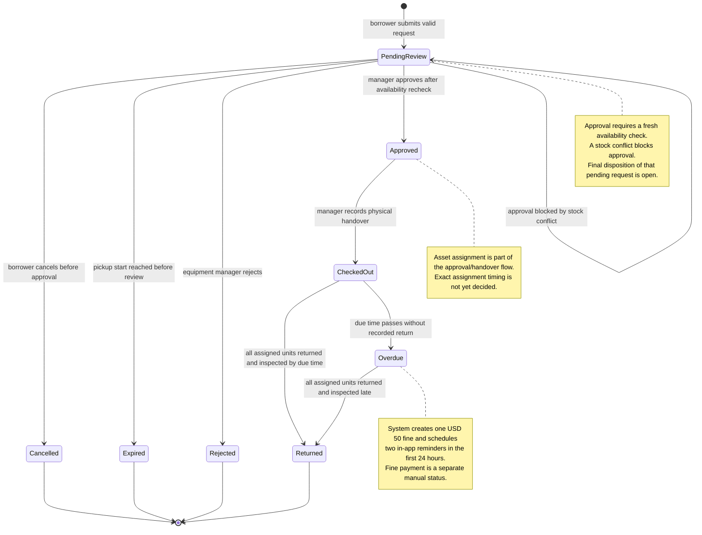

# BorrowHub MVP — Borrow Request State Diagram

## Purpose

يوضح دورة حياة كيان **Loan Request**، وهو الطلب الذي يصبح سجل الاستعارة عند اعتماده. يفصل المخطط الحالات النهائية والانتقالات التي تسببها أفعال المستعير أو مسؤول المعدات أو أحداث النظام، ويبين الانتقالات غير المسموحة بحسب قواعد PRD.

## Source requirements

- `docs/PRD.md`: FR-012–FR-020, FR-024–FR-029، حالات الطلب في Sections 7 و8 و13 و18.
- `docs/user-flow.md`: الإلغاء، الرفض، انتهاء الطلب، الاعتماد، التسليم، الإرجاع والتأخير.
- `docs/ERD.md` و`docs/database.dbml`: `loan_requests`, `asset_assignments`, `fines`.

## Valid code

## الشرح بالعربية

- **البداية:** ينتقل الطلب إلى `PendingReview` بعد اجتياز التحقق عند الإرسال.
- من الانتظار يمكن للمستعير الإلغاء قبل الموافقة، أو قد ينتهي الطلب تلقائيًا عند بداية وقت الاستلام إذا لم تتم مراجعته، أو يرفضه مسؤول المعدات.
- الاعتماد لا يحدث إلا بعد إعادة فحص التوفر. إذا لم تتوفر الكمية، تمنع الموافقة ويبقى الطلب في حالة الانتظار إلى أن يقرر المسؤول ما إذا كان سيرفضه؛ هذا المسار النهائي غير محسوم في PRD.
- بعد الموافقة يسجل مسؤول المعدات التسليم الفعلي فينتقل الطلب إلى `CheckedOut`.
- إذا سُجل الإرجاع والفحص قبل الموعد ينتقل إلى `Returned`. إذا مر الموعد دون تسجيل الإرجاع ينتقل إلى `Overdue`، وينشأ سجل غرامة مستقل واحد وتُرسل التذكيرات. عند الإرجاع المتأخر ينتقل الطلب إلى `Returned` بينما قد تبقى الغرامة غير مدفوعة.
- حالة الغرامة ليست حالة للطلب؛ تُدار في كيان `Fine` منفصل حتى لا تختلط حالة حيازة المعدّة بحالة التحصيل.

### انتقالات غير صالحة وفق المتطلبات الحالية

- `PendingReview → CheckedOut` غير مسموح دون اعتماد وتسجيل التسليم.
- `Approved → Cancelled` لا يسمح به عبر إجراء المستعير؛ الإلغاء من المستخدم قبل الموافقة فقط.
- `Rejected`, `Cancelled`, `Expired`, أو `Returned` لا تعود إلى `PendingReview` في نفس السجل.
- لا تسجل `Returned` قبل تسجيل الإرجاع والفحص للقطع المخصصة. معيار إغلاق الطلب عند الإرجاع الجزئي يحتاج حسمًا.
- لا يعتمد النظام طلبًا منتهيًا أو يخصص قطعة بعد أن أصبحت غير متاحة.

## Assumptions

- الحالات من PRD مع تمثيل موحد للطلب والاستعارة؛ التخصيص المادي وحالة الغرامة سجلات منفصلة.
- الانتقال إلى `Returned` عند اكتمال إرجاع/فحص كل القطع هو قاعدة اتساق مقترحة للمخطط؛ التوقيت النهائي لعلاقة الإرجاع والفحص يحتاج قرار مالك المنتج.
- فرع انتهاء الطلب عند وقت الاستلام قرار موثق في PRD بناء على تفويض المالك للمحلل.

## Open questions

- ما التعريف الدقيق لـ“active loan” ولحظة الخروج من الحد الأقصى لاستعارتين؟
- هل الإرجاع الجزئي ممكن، ومتى يصبح الطلب Returned؟
- بعد تعارض التوفر عند الموافقة، هل يرفض المسؤول الطلب أم يبقيه معلقًا أم يعيده للتعديل؟
- هل تنتهي الغرامة أو الحظر عند الإرجاع أم بعد تسجيل السداد؟ (الـPRD يحظر الطلبات الجديدة عند التأخير أو الغرامة غير المدفوعة.)
- متى يتم تعيين القطع الفردية بالضبط؟
- هل توجد فترة سماح قبل الانتقال إلى Overdue؟
