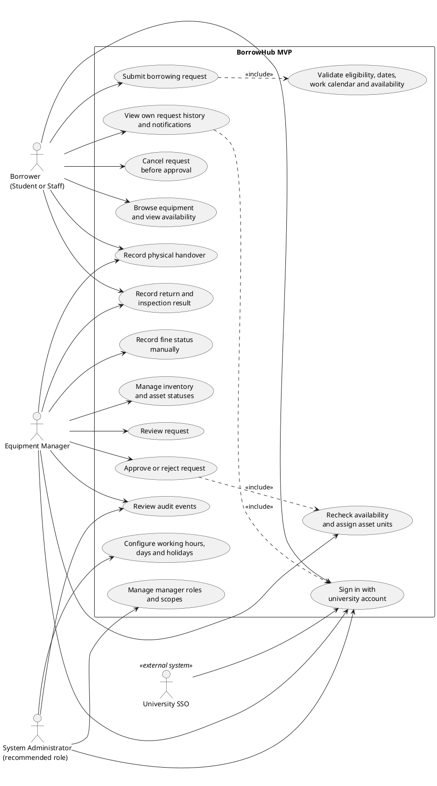

# BorrowHub MVP — Use Case Diagram

## Purpose

يحدد مخطط حالات الاستخدام من يتفاعل مع BorrowHub وما الوظائف الداخلة في MVP. يشمل مسار المستعير ومسؤول المعدات ودور مدير النظام الموصى به، إضافة إلى مزود SSO بوصفه نظامًا خارجيًا مساعدًا.

## Source requirements

- `docs/PRD.md`: Users/Roles, MVP Scope, FR-001–FR-030, NFR-001–NFR-002.
- `docs/user-flow.md`: المسار الرئيسي من تسجيل الدخول إلى الإرجاع والغرامة.
- `docs/ERD.md` و`docs/database.dbml`: الكيانات، النطاقات، الإشعارات، والتقويم.

## Valid code

## الشرح بالعربية

- **الفاعل الأساسي الأول: Borrower (طالب أو موظف)**: يستعرض التوفر، يقدم طلبًا، يرى السجل والإشعارات، ويلغي الطلب قبل الموافقة. صفتي الطالب والموظف لهما التدفق نفسه بحسب PRD.
- **الفاعل الأساسي الثاني: Equipment Manager**: يراجع الطلبات ضمن نطاقه، يقرر الموافقة أو الرفض، يعيد التحقق من التوفر ويعين القطع، ويسجل التسليم والإرجاع والفحص ويحدث السداد يدويًا.
- **الفاعل الإداري: System Administrator**: دور موصى به في PRD لإدارة نطاقات المسؤولين وتقويم العمل؛ الصلاحيات النهائية تحتاج اعتمادًا مؤسسيًا.
- **الفاعل الثانوي: University SSO**: خدمة خارجية تتحقق من هوية الجامعة. مزود SSO وبروتوكوله غير محددين.
- حالة الاستخدام “Submit borrowing request” تتضمن التحقق من حد الطلبات النشطة، وجود تأخير/غرامة غير مدفوعة، صحة فترة العشرة أيام، ساعات العمل، والتوفر.
- عند قرار الموافقة يعاد فحص التوفر وتُربط القطع الفردية بالطلب. لا توجد حالة استخدام دفع إلكتروني، بريد/SMS أو QR لأنها مستبعدة من MVP.

العلاقة `include` بين القرار وتخصيص القطع تصف أن التخصيص مطلوب ضمن مسار الاعتماد/التسليم، لكنها لا تحسم نقطة التوقيت الدقيقة؛ هذه نقطة مفتوحة في PRD.

## Assumptions

- مستعير الطالب والموظف فاعل واحد لأن السياسة والرحلة لا تختلفان في الوثائق.
- SSO ممثل كفاعل ثانوي خارجي؛ التكامل الفعلي لمزود الهوية لم يُحدد.
- مدير النظام مفصول عن مسؤول المعدات وفق توصية PRD، وليس دورًا مؤسسيًا نهائيًا مؤكدًا.
- تسجيل الغرامة المدفوعة مسؤولية موظف مخول؛ لا تتم معالجة دفع مالي داخل النظام.

## Open questions

- هل يستطيع مسؤول المعدات أيضًا استخدام النظام كمستعير؟
- هل مدير النظام يرى التدقيق لكل الجامعة أم ضمن سياسة محددة؟
- ما النطاق الأولي للحرم/الكلية/القسم؟
- هل طلب الاستعارة يشمل نوعًا واحدًا أم عدة أنواع؟
- ما التوقيت المحدد لتعيين القطع بالنسبة للموافقة والتسليم؟
- من هو مزود SSO وما السمات التي ترجعها الهوية؟
