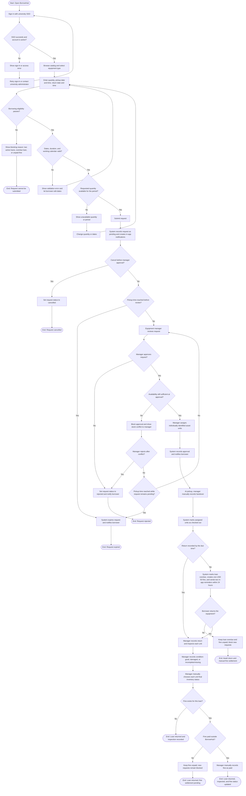

# BorrowHub — User Flow: Equipment Borrowing

## الدور الرئيسي

**المستعير (طالب أو موظف)** هو الدور الرئيسي في بداية الرحلة. يشارك **مسؤول المعدات** في المراجعة والتخصيص والتسليم والإرجاع. يتحقق النظام تلقائيًا من الشروط والمواعيد والتوفر. تسجيل الدخول يتم عبر SSO الجامعي.

## هدف التدفق

تمكين المستعير من طلب معدّة متاحة لفترة صحيحة، ومتابعة قرار مسؤول المعدات، ثم استلام القطع ذات المعرّفات الفردية وإعادتها مع تسجيل الفحص. يغطي المسار الاعتيادي ومسارات الرفض والإلغاء وانتهاء الطلب والتأخير، ضمن نطاق MVP المحدد في `docs/PRD.md`.

## نقاط الدخول والخروج

- **الدخول:** فتح BorrowHub ثم تسجيل الدخول بحساب الجامعة الموحد.
- **الخروج الناجح:** تسجيل الإرجاع وفحص القطع، مع حالة نهائية يحددها مسؤول المعدات؛ وإذا كان هناك تأخير، يبقى سجل الغرامة حتى تسويته يدويًا.
- **مخارج بديلة:** تعذر الدخول/الصلاحية، تعذر اجتياز التحقق، إلغاء قبل الموافقة، رفض الطلب، انتهاء الطلب قبل المراجعة، أو بقاء الطلب غير محسوم عند تعارض التوفر.

## مخطط Mermaid

## شرح الرحلة والقرارات

### 1. الدخول واختيار المعدّة

يبدأ المستخدم بتسجيل الدخول عبر SSO الجامعي. إذا فشل التحقق أو لم يكن الحساب نشطًا/مصرحًا، يعرض النظام حالة خطأ ولا يسمح بمتابعة الطلب. بعد الدخول، يستعرض المستخدم الكتالوج ويختار نوع المعدّة، ثم يدخل الكمية ووقت الاستلام ووقت الإرجاع.

### 2. التحقق من أهلية الطلب وصحة المواعيد

قبل إرسال الطلب، يتحقق النظام من أن المستعير لا يتجاوز حد **استعارتين نشطتين معتمدتين**، ولا توجد لديه استعارة متأخرة أو غرامة غير مدفوعة. الطلبات قيد المراجعة لا تدخل في حد الاستعارتين. إذا فشل شرط أهلية، يمنع النظام الإرسال ويعرض السبب.

يتحقق النظام أيضًا من أن مدة الاستعارة لا تتجاوز **10 أيام تقويمية متتالية**، وأن أوقات الاستلام والإرجاع ضمن ساعات وأيام العمل المهيأة وغير واقعة في عطلة. عند خطأ في التاريخ أو المدة، يعود المستخدم لتعديلها.

### 3. التوفر والإرسال

يتحقق النظام من توفر الكمية طوال الفترة المطلوبة. إذا لم تكن متاحة، يمنع الإرسال ويتيح للمستخدم تعديل الكمية أو المواعيد. إذا كانت متاحة، يسجل الطلب بحالة «قيد المراجعة» ويرسل إشعارًا داخل التطبيق للمستعير ولمسؤول المعدات المعني.

### 4. الإلغاء والمراجعة

يمكن للمستعير إلغاء الطلب قبل موافقة مسؤول المعدات. إذا لم يلغِه، ينتظر مراجعة المسؤول. وفق قرار موثق في PRD بتفويض المستخدم للمحلل باختيار الأنسب، ينتهي الطلب تلقائيًا عند بداية موعد الاستلام إذا بقي دون مراجعة، ويُخطر المستعير.

يختار مسؤول المعدات الموافقة أو الرفض؛ لا يلزمه إدخال سبب للرفض. عند الرفض، يتغير وضع الطلب ويُخطر المستعير. عند محاولة الموافقة، يعيد النظام التحقق من التوفر حتى لا تعتمد كمية لم تعد متاحة.

### 5. تعارض التوفر عند الموافقة

إذا لم تعد الكمية متاحة، يمنع النظام الموافقة ويعرض التعارض للمسؤول. لا يحدد PRD بصورة نهائية هل ينبغي إبقاء الطلب معلقًا أو رفضه أو إعادته للمستعير للتعديل. يبيّن المخطط لذلك فرعًا يمكن فيه للمسؤول رفض الطلب، أو إبقاؤه معلقًا حتى يقرر، مع انتهاء تلقائي عند بداية موعد الاستلام.

### 6. التخصيص والتسليم والإرجاع

بعد نجاح إعادة التحقق، يخصص مسؤول المعدات القطع الفعلية ذات المعرّفات الفردية، ثم يسجل التسليم يدويًا عند حضور المستعير. يسجل النظام القطع بوصفها مستعارة.

عند الإرجاع، يسجل المسؤول الإرجاع ونتيجة الفحص: سليمة، متضررة، أو ناقصة. يحدد المسؤول الحالة النهائية لكل قطعة يدويًا؛ لا يغير النظام الحالة النهائية تلقائيًا بناء على نتيجة الفحص.

### 7. التأخير والغرامة

إذا لم يسجل الإرجاع بحلول الموعد، يعلّم النظام الاستعارة متأخرة، وينشئ **غرامة واحدة قدرها 50 دولارًا لكل استعارة متأخرة**، ويرسل تذكيرين داخل التطبيق خلال أول 24 ساعة. توقيتا التذكيرين الدقيقان لم يُحسما.

يستمر مسار الإرجاع والفحص حتى لو كان الإرجاع متأخرًا. لا توجد بوابة دفع في MVP؛ يسجل مسؤول المعدات حالة السداد يدويًا بعد الدفع خارج النظام. وتظل الطلبات الجديدة محظورة عند وجود استعارة متأخرة أو غرامة غير مدفوعة، وفق الاختيار الذي اتخذه المحلل بتفويض المستخدم.

## القواعد والتحققات ذات الصلة

| القاعدة | سلوك النظام في هذا التدفق |
|---|---|
| تسجيل الدخول | حساب الجامعة الموحد SSO؛ الحساب غير المصرح له لا يتابع |
| مدة الاستعارة | حد أقصى 10 أيام تقويمية متتالية |
| حد الاستعارات النشطة | طلبان معتمدان نشطان كحد أقصى؛ الطلب المعلق لا يُحسب |
| الحظر بسبب التأخير/الغرامة | لا طلب جديد مع استعارة متأخرة أو غرامة غير مدفوعة |
| ساعات وأيام العمل | المواعيد خارج الإعدادات أو في العطل ممنوعة |
| التوفر | يفحص عند الإرسال ويعاد الفحص عند الموافقة |
| الموافقة | جميع الطلبات تتطلب قرار مسؤول معدات |
| الإلغاء | متاح للمستعير قبل الموافقة فقط |
| تعيين القطع | القطع ذات المعرّف الفردي يخصصها المسؤول |
| التسليم والإرجاع | يسجلهما مسؤول المعدات يدويًا |
| الفحص | سليمة/متضررة/ناقصة؛ المسؤول يحدد الحالة النهائية يدويًا |
| الغرامة | 50 USD مرة واحدة لكل استعارة متأخرة؛ السداد يسجل يدويًا |
| الإشعارات | داخل التطبيق؛ لا بريد أو SMS في MVP |

## الأسئلة المفتوحة

1. هل يغطي الإطلاق الحرم الجامعي كاملًا أم كلية/قسمًا محددًا؟
2. هل تحجز الطلبات المعلقة كمية مؤقتًا؟ لم يحسم PRD ذلك.
3. متى يخصص المسؤول القطع الفردية تحديدًا: عند الموافقة أم قبيل التسليم؟
4. إذا تغير التوفر أثناء المراجعة، هل يرفض المسؤول الطلب أو يبقيه معلقًا أو يعيده للتعديل؟
5. متى تنتهي صفة «استعارة نشطة» لأغراض الحد الأقصى: عند تسجيل الإرجاع أم بعد اكتمال الفحص؟
6. ما المنطقة الزمنية المعتمدة، وهل توجد فترة سماح بعد موعد الإرجاع قبل تسجيل التأخير؟
7. ما توقيتا التذكير داخل أول 24 ساعة؟
8. ما الإجراء عند عدم حضور المستعير للاستلام بعد الموافقة؟
9. ما السياسة المعتمدة للغرامة البالغة 50 دولارًا، ومن يملك صلاحية تسجيل الدفع أو تصحيح حالته؟

## Mermaid code (copy separately)

